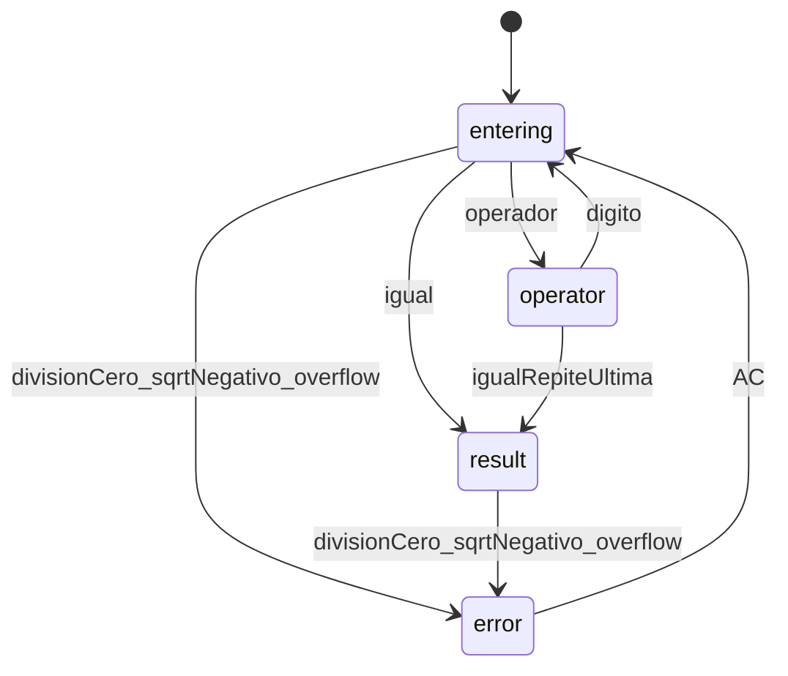

# Calculadora full-stack (Go + React)

Se mantiene el encargo original: TDD estricto, una fase (y los pasos 2a, 2c, 3a, 3c) a la vez, y parada hasta tu aprobación. No hay código de producción antes de que veas los tests en rojo.

## Repositorio

El repositorio de trabajo es **sezzle**.

- Nombre del proyecto, del compose y del módulo Go: `sezzle`.
- Título de `README.md` y de `agent.md`: sezzle.
- El código sigue en la raíz de ese repo, partido en `/frontend` y `/backend`. No se crea otro directorio con el nombre del repo.

## Qué se agrega ahora

- [`promps.md`](promps.md) en la raíz, con el primer mensaje de esta sesión copiado tal cual (el plan de fases, las reglas de TDD y los requisitos). El nombre del archivo es el que pediste: `promps.md`.
- El frontend no es un formulario de dos campos. Es una calculadora de un solo display y teclado.
- Docker de desarrollo con volúmenes y recarga en vivo queda en la Fase 1, junto con los comandos de abajo. El `Dockerfile` de producción sigue en la Fase 4.

## Decisiones de API (las que quedaron propuestas)

- `POST /api/calculate` con `{ "operation", "a", "b" }`.
- Operaciones: `add`, `sub`, `mul`, `div`, `exp` (`a^b`), `sqrt` (solo `a`; `b` se ignora), `percent` (`a / 100`, unaria).
- Éxito: `200` y `{ "result": number }`. Error de dominio o de entrada: `400` y `{ "error": "..." }`.
- El porcentaje “de calculadora” (200 + 10% = 220) lo resuelve el frontend y después llama a `add` / `sub` / `mul` / `div`. El backend solo hace `a / 100`.

## Errores en el frontend (calculadora real)

Un solo display. Estados: `entering`, `operator`, `result`, `error`.



- **Entrada, sin red.** Un segundo punto decimal se ignora. Los ceros a la izquierda se descartan salvo `0.`. Tope de 12 dígitos en el display; el resto no entra. Pulsar otro operador reemplaza al pendiente. `±` cambia el signo. `⌫` borra un dígito del número en curso. `C` borra el número en curso. `AC` borra todo.
- **Micro historial.** Encima del número, la línea superior muestra la operación en curso completa, no solo el operador pendiente. `2 + 2 +` queda visible al encadenar, y el número que se está escribiendo se suma a esa línea (`2 + 2 + 5`). Al confirmar con `=` queda la expresión (`2 + 2 + 5 =`). Reemplazar el operador actualiza el último símbolo (`5 +` pasa a `5 −`). `AC` borra el historial junto con el resto.
- **Porcentaje, estilo calculadora.** Sin operación pendiente, `50%` pasa a `0.5` (`percent`). Con `+` o `−`, el segundo número es el porcentaje del primero (`200 + 10%` llama a `add(200, 20)`). Con `×` o `÷`, el segundo número pasa a fracción (`200 × 10%` llama a `mul(200, 0.1)`; `200 ÷ 10%` llama a `div(200, 0.1)`).
- **Error de matemática.** División por cero, raíz de negativo o resultado no finito: el display muestra `Error`, el teclado queda mudo y solo `AC` recupera. El cliente lo detecta antes de la petición cuando puede, y también traduce un `400` del API al mismo estado.
- **Error de red.** El display no se sustituye por `Error`. Debajo aparece `Sin conexión` y `=` reintenta. Así se distingue un fallo del aparato de un fallo del servicio.
- Tests de UI (Fase 3c, antes del componente): punto doble ignorado, división por cero deja `Error` y bloquea dígitos hasta `AC`, raíz negativa, `200 + 10%`, reemplazo de operador, y fallo de red con el texto `Sin conexión`.

## Comandos Docker para ver cambios

Quedan escritos también en el `README.md` de la Fase 1. Hay que ejecutarlos desde la raíz del repo, cuando existan [`docker-compose.yml`](docker-compose.yml) y los `Dockerfile.dev`.

```bash
docker compose up --build
```

- App (frontend): `http://127.0.0.1:3000`
- API: `http://127.0.0.1:8081`

Ese proceso sigue en primer plano. Al editar `.tsx` / `.css` el navegador se actualiza solo (Vite, con `server.watch.usePolling` porque el bind mount de Docker no avisa bien los cambios). Al editar `.go`, Air recompila el API.

```bash
docker compose logs -f
docker compose down
```

Si solo cambian dependencias (`go.mod` o `package.json`), hace falta otro `docker compose up --build`. Un cambio de código de la calculadora no exige reconstruir la imagen.

Producción (Fase 4), imagen única multi-stage, sin recarga en vivo:

```bash
docker compose -f docker-compose.prod.yml up --build
```

## Cobertura

La cobertura de tests del backend y del frontend tiene que ser **superior al 95 %**, incluyendo casos borde: división por cero (también con cero negativo), raíz de un número negativo, overflow o resultado no finito, operación desconocida, JSON vacío o inválido, tope de 12 dígitos, ceros a la izquierda, segundo punto decimal, porcentaje de calculadora (`+`, `−`, `×`, `÷` y sin operación) y fallo de red.

```bash
go test ./... -coverprofile=coverage.out
go tool cover -func=coverage.out
```

La línea `total` tiene que quedar por encima del 95 %. En el frontend, `npm test -- --coverage` exige el mismo umbral en sentencias, líneas y funciones.

## Fases (sin saltar ninguna)

**Fase 1 — Andamiaje y docs.** Carpetas `/frontend` y `/backend`. [`agent.md`](agent.md) con stack, API, máquina de estados de errores y la regla de TDD. [`README.md`](README.md) esqueleto con los comandos Docker de arriba. [`promps.md`](promps.md) con el primer mensaje. `docker-compose.yml` y Dockerfiles de desarrollo (Go con Air, Vite publicado en el puerto **3000**). Parar.

**Fase 2 — Backend TDD.** Módulo Go `sezzle/backend` en `/backend`, librería estándar `net/http` y `testing`. 2a tests de matemática en rojo y espera. 2b implementación. 2c tests HTTP en rojo y espera. 2d handlers y router. Comando de cobertura: `go test ./... -cover`. Parar.

**Fase 3 — Frontend TDD.** Vite + React + TypeScript en `/frontend`. Vitest y Testing Library. Tailwind para el tema oscuro. Fuente Barlow. Iconos `lucide-react`. 3a tests del cliente API y de la lógica de porcentaje / validación, en rojo, y espera. 3b implementación. 3c tests del display y del teclado (incluidos los de error), en rojo, y espera. 3d UI. Parar.

**Fase 4 — Producción y cierre.** `Dockerfile` multi-stage y `docker-compose.prod.yml`: el binario Go sirve el build estático del frontend y el API bajo `/api`, publicado también en el puerto **3000** (`http://127.0.0.1:3000`). README completo: puesta en marcha, comandos, ejemplos `curl`, sección Design Decisions. Revisión contra el encargo original. Al terminar esta fase, ejecutar la revisión de código de la sección siguiente sobre el código entregado y sus tests.

## Revisión de código al terminar

Al cerrar el trabajo (después de la Fase 4, con backend, frontend, tests y Docker de producción en el repo), realizar un code review exhaustivo del código entregado y de sus tests. Actuar como Senior Software Engineer experto en calidad de software, arquitecturas escalables y revisión de código. Evaluar el código estrictamente con estos criterios:

1. Buenas Prácticas y Arquitectura:
   - Verificar el cumplimiento de SOLID, DRY y KISS.
   - Asegurarse de que las responsabilidades estén separadas (lógica de negocio aislada de handlers HTTP y de componentes visuales, inyección de dependencias donde corresponda).

2. Uso de Constantes y Variables:
   - Rechazar magic numbers y cadenas hardcodeadas. Todo valor estático o de configuración debe estar en constantes (`UPPER_SNAKE_CASE`) o enums.
   - Revisar el alcance de las variables, priorizando inmutabilidad y evitando mutaciones innecesarias de estado.

3. Calidad y Cobertura de Tests (unitarios e integración):
   - Verificar que los tests cubran casos extremos, fallos esperados y no solo el happy path.
   - Evaluar que mocks, spies o stubs no se acoplen de más a los detalles de implementación.
   - Exigir aserciones significativas y descriptivas.

4. Tipado Estricto y Convenciones:
   - En TypeScript, exigir tipado estricto. Marcar como advertencia grave el uso de `any`, aserciones `as Type` o tipos inferidos pobremente.
   - Revisar que los nombres de variables, funciones y métodos revelen su intención.

5. Rendimiento, Seguridad y Manejo de Errores:
   - Identificar bucles ineficientes, renderizados innecesarios, problemas de concurrencia o consultas costosas.
   - Verificar que las excepciones se capturen y se manejen sin exponer detalles sensibles de la infraestructura.

Formato de salida obligatorio de esa revisión:

- 🔴 **Crítico (Bloqueante):** errores que rompen la aplicación, fallos de seguridad o violaciones graves de diseño.
- 🟡 **Mejoras Recomendadas:** sugerencias de legibilidad, modularidad, tipado o tests.
- 🟢 **Lo que está bien:** reconocimiento breve de buenas implementaciones.
- 🛠️ **Refactorización Propuesta:** bloques de código refactorizado con comentarios breves del porqué del cambio.

El repositorio es ~/Público/Sezzle/sezzle

## Registro de prompts

Ante cada prompt nuevo de este proyecto, hay que actualizar [`promps.md`](promps.md) con esa orden antes de cerrar el trabajo.

### Tests de integración con Playwright

Quiero que verifiques agregues tests de integracion para todas las operaciones de la calculadora con playwrite y que edites el archivo promps esta orden y que tambien agregues que tenes la regla de modificar este archivo en este proyecto ante nuevos promps.

Los tests viven en [`frontend/e2e/operations.spec.ts`](frontend/e2e/operations.spec.ts) y cubren `+`, `−`, `×`, `÷`, `xʸ`, `√` y `%` contra la app en `http://127.0.0.1:3000` y el API en `http://127.0.0.1:8081`. Se ejecutan con `npm run test:e2e` desde `/frontend`, con el compose de desarrollo ya levantado.
